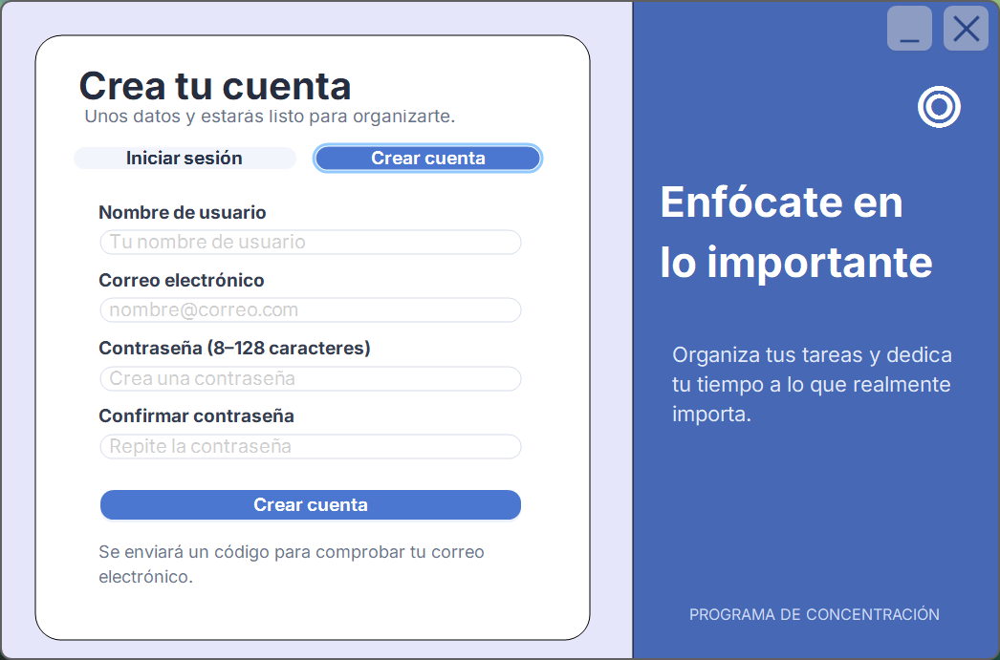
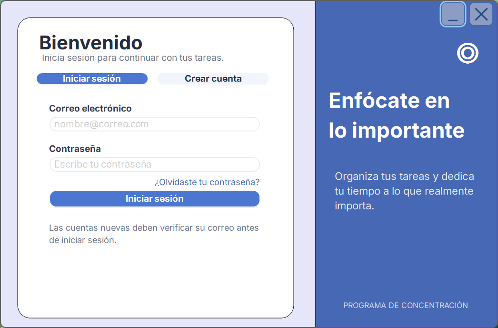
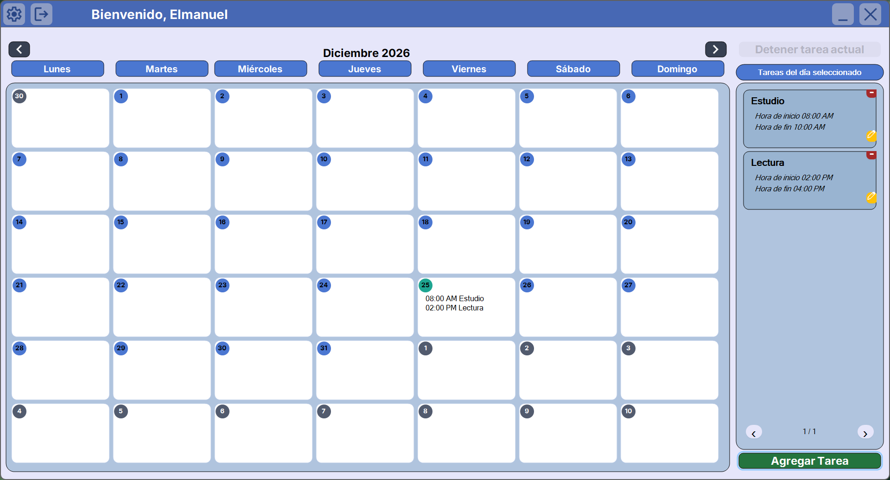
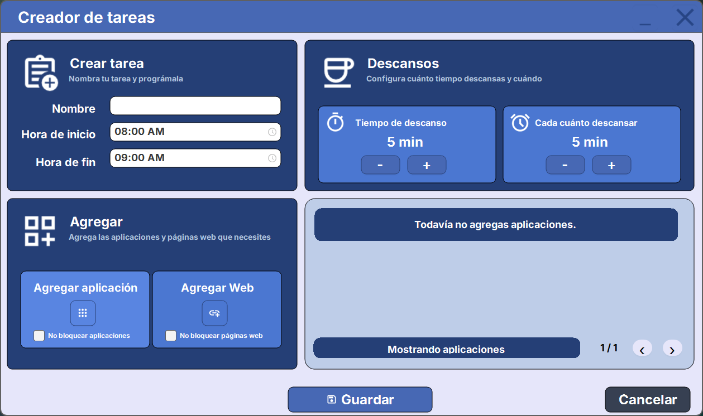
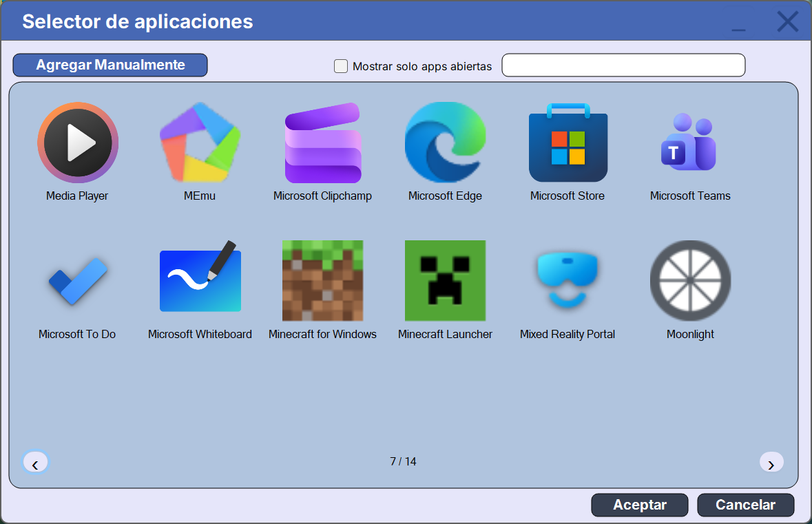
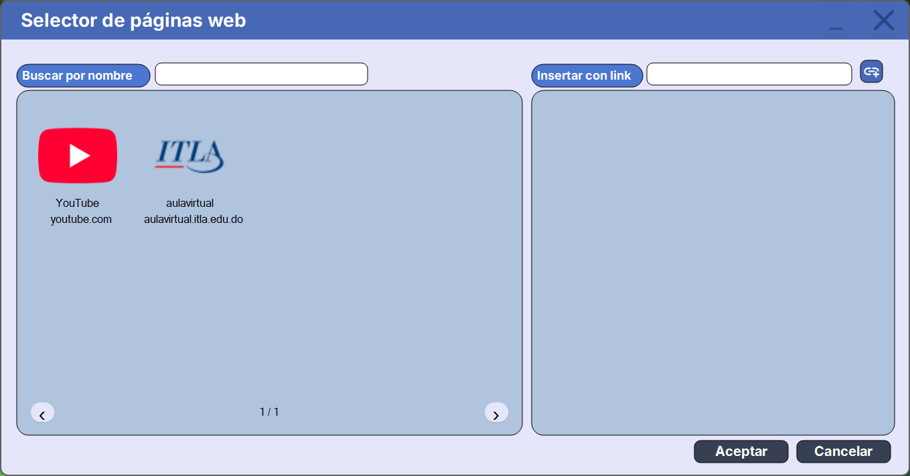
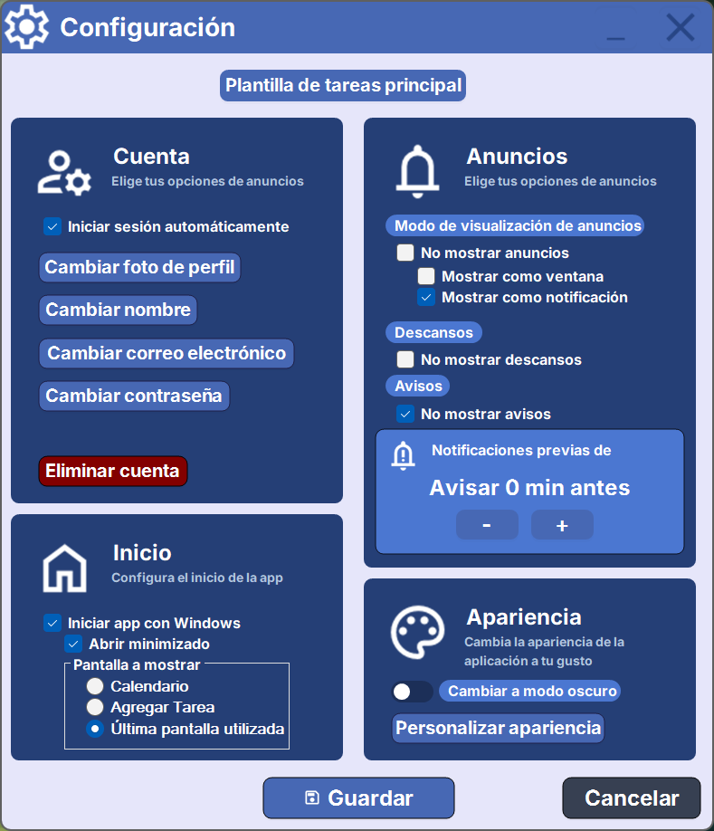
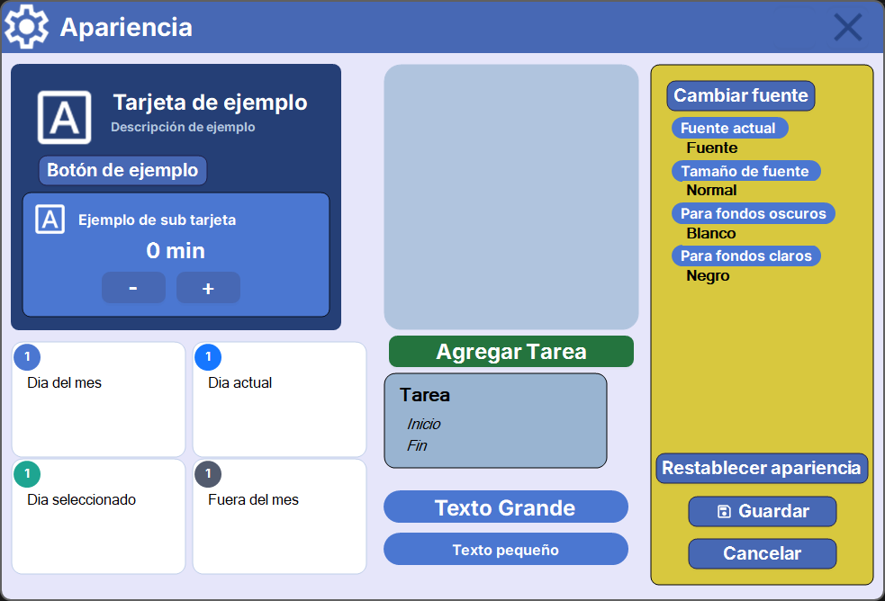
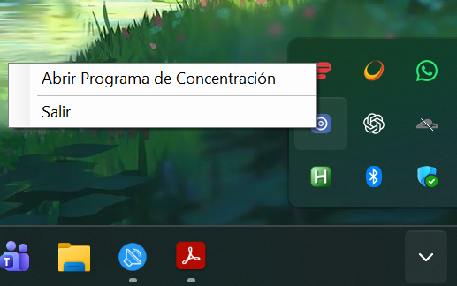

# Manual de usuario - Programa de Concentración

## Índice

1. Conocer el programa
2. Instalar y entrar
3. Planificar tareas
4. Asociar aplicaciones y sitios
5. Descansos, bloqueos y avisos
6. Preferencias y cuenta
7. Bandeja del sistema
8. Ayuda y limitaciones visuales

## 1. Conocer el programa

Programa de Concentración ayuda a organizar el tiempo de enfoque. Permite crear tareas en un calendario, asociarlas a aplicaciones o sitios web, programar descansos y aplicar bloqueos durante una tarea. Los datos pueden conservarse localmente y sincronizarse cuando vuelve la conexión.

## 2. Instalar y entrar

### Instalar

1. Descomprime el ZIP de instalación completo.
2. Ejecuta `Instalar.vbs` dentro de la carpeta descomprimida.
3. Espera a que finalice. Si Windows muestra una solicitud de autorización, revisa el nombre del programa antes de aceptarla.
4. Abre **Programa de Concentración** desde el menú Inicio.

El instalador puede descargar .NET Framework 4.8 si el equipo no lo tiene.

Al abrir el programa, si hay una versión más reciente publicada, aparecerá una pregunta para instalarla. Si aceptas, Windows solicitará autorización para actualizar; el programa se cerrará durante la instalación y se abrirá de nuevo al finalizar.

### Crear una cuenta

1. En la pantalla de acceso, abre la pestaña **Registro**.
2. Escribe un nombre de usuario, correo y contraseña; repite la contraseña.
3. El nombre admite letras, números y guion bajo, hasta 50 caracteres. No escribas espacios ni símbolos.
4. Pulsa **Registrar**. Si el correo necesita verificación, sigue el paso para introducir el código enviado.

### Iniciar sesión

Escribe el correo y la contraseña y pulsa **Iniciar sesión**. Si ya habías iniciado sesión en el equipo, la aplicación puede permitir el acceso sin conexión con los datos locales disponibles.

## 3. Planificar tareas

El calendario es la pantalla principal. Selecciona un día para ver sus tareas y usa las flechas para cambiar de mes.

Al agregar o editar una tarea, indica su nombre y horario. En el panel **Descansos**, ajusta cuánto durará cada pausa y cada cuánto tiempo se repetirá. Pulsa **Guardar** para crear la tarea.

1. En la vista principal, pulsa el control para agregar una tarea.
2. Escribe el nombre y define la hora de inicio y fin.
3. Configura si corresponde un descanso y las aplicaciones o webs relacionadas.
4. Guarda la tarea. Debe aparecer en la lista del día seleccionado.
5. Para revisar una tarea, selecciónala en la lista. Usa sus acciones disponibles para editar, iniciar, detener o eliminar según su estado.

Una tarea programada puede cambiar de pendiente a activa al llegar su hora. Comprueba las fechas y horas antes de guardarla.

## 4. Asociar aplicaciones y sitios

### Aplicaciones

Desde el formulario de tarea, abre la selección de aplicaciones y elige una aplicación de la lista. Puedes activar **Mostrar solo apps abiertas** para filtrar la lista, usar **Agregar manualmente** si no aparece la aplicación o avanzar con las flechas para ver más resultados. Selecciona la aplicación y pulsa **Aceptar** para asociarla; usa **Cancelar** para salir sin guardar la selección.

### Sitios web

En el mismo formulario, abre el selector de páginas web. Puedes buscar un sitio por nombre o escribir un enlace y pulsar el botón de insertar. El sitio agregado aparecerá en la lista; selecciónalo y pulsa **Aceptar** para asociarlo a la tarea. Las páginas seleccionadas quedan permitidas durante la tarea; comprueba el dominio para asegurarte de permitir el sitio que necesitas.

Las reglas de bloqueo dependen de que el supervisor correspondiente esté disponible en Windows y de los permisos del equipo. No todos los navegadores o políticas de red responden igual.

## 5. Descansos, bloqueos y avisos

Configura duración y cantidad de descansos en la tarea o en ajustes. Durante un periodo de descanso se muestra una cuenta regresiva. Cuando el descanso termina, la aplicación avisa para volver a la tarea.

En ajustes puedes determinar cómo recibir avisos: como notificación del icono o como ventana, además de desactivar categorías de avisos. Si el programa está oculto en la bandeja, la actualización evita abrir automáticamente las ventanas de recordatorio; la actividad de la tarea sigue ejecutándose en segundo plano.

## 6. Preferencias y cuenta

Pulsa el botón de configuración en la pantalla principal. Allí puedes cambiar opciones de inicio, avisos, apariencia y datos de la cuenta. Para cambiar el nombre de usuario, usa solo letras, números y guion bajo. El cambio se valida antes de guardarse. El correo puede requerir verificación de nuevo.

Los cambios de cuenta o preferencias se aplican al confirmarlos. Usa **Cerrar sesión** si quieres volver a la pantalla de acceso sin cerrar la aplicación de manera forzada.

En la pantalla de configuración puedes elegir cómo inicia la aplicación, qué avisos mostrar y cómo se ve. Revisa cada opción y pulsa **Guardar** para conservar los cambios.

### Personalizar apariencia

En **Personalizar apariencia** puedes revisar los cambios en una vista previa antes de aplicarlos. Pulsa **Cambiar fuente** para elegir otra tipografía y ajusta el tamaño con las opciones de texto grande y pequeño. También puedes definir el color del texto para fondos oscuros y claros, para conservar el contraste en ambos modos. **Restablecer apariencia** recupera la configuración visual inicial; pulsa **Guardar** para aplicar los cambios o **Cancelar** para descartarlos.

## 7. Bandeja del sistema

- **Minimizar:** usa el botón de minimizar de la ventana. Esta acción oculta el programa en el área de iconos junto al reloj.
- **Cerrar con la X:** oculta la ventana y deja el programa activo en segundo plano.
- **Volver a abrir:** haz doble clic en el icono del programa o abre su menú y selecciona **Abrir Programa de Concentración**.
- **Salir completamente:** abre el menú del icono y selecciona **Salir**. Esto detiene supervisores y temporizadores.

Ocultar la ventana no equivale a salir. Mientras está oculta, la tarea y la sincronización pueden continuar. Un aviso de Windows puede aparecer sobre el icono según las preferencias de notificación.

En el menú del icono, selecciona **Abrir Programa de Concentración** para mostrar la ventana de nuevo o **Salir** para cerrar el programa completamente.

## 8. Ayuda y limitaciones visuales

Esta edición incorpora capturas reales de las pantallas de acceso, registro, calendario, creación de tareas con descansos, selección de aplicaciones y páginas web, configuración, personalización de apariencia y menú de la bandeja del sistema. Las capturas de las demás funciones se añadirán al recibirlas. No se usan mockups ni imágenes de otra aplicación.

Si aparece un error, anota el mensaje y contacta con quien administra la instalación. No borres la base local ni los archivos pendientes de sincronización. Si no se puede iniciar sesión, revisa conexión y vuelve a intentar; una cuenta que ya usó el equipo puede disponer de inicio sin conexión.
